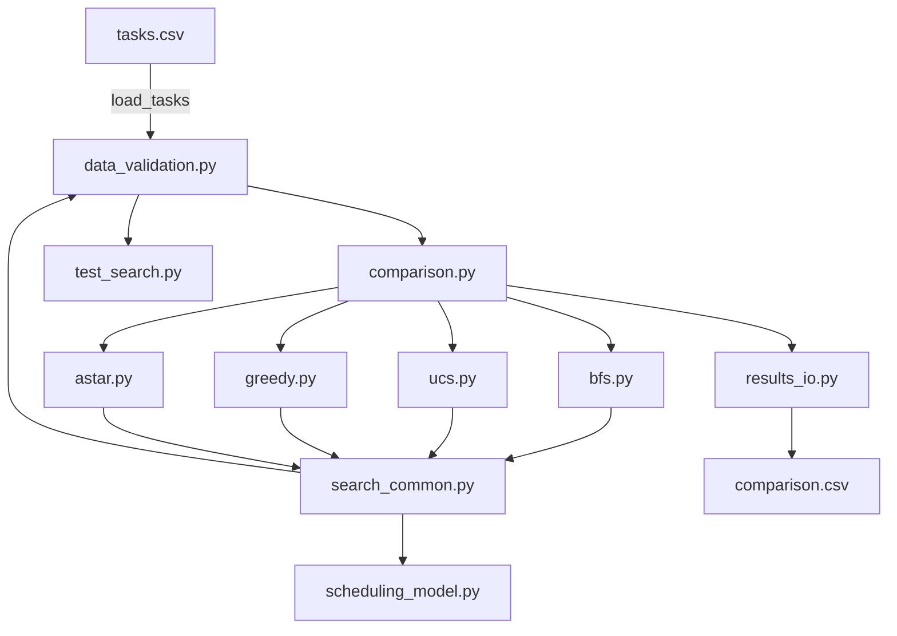
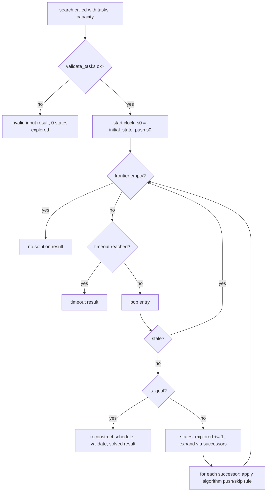

# Design Document: Phase 2 Search Algorithms

## Overview

Phase 2 adds four search algorithms (BFS, UCS, Greedy Best-First, A*) over the Phase 1 scheduling model. All four solve the same problem through the same Phase 1 API (`initial_state`, `successors`, `is_goal`, `validate_schedule`). Only the frontier discipline differs. A shared helper module holds everything else: input checking, the generic search loop, schedule reconstruction, timing, counting and result building.

Findings from reading the Phase 1 code that shape this design:

- `successors()` already returns the "start nothing and wait" successor when something is running, and one successor per non-empty fitting subset of ready tasks. With T01 done and nothing running it returns exactly 6 successors (the existing test `test_legal_start_groups_at_day_2` confirms this). Delays are therefore representable and **no change to `scheduling_model.py` is planned** (Requirement 1.7 is not triggered). Requirement 1 is covered by new tests only.
- `State` has no clock. Search code tracks `g` (elapsed days) itself, and reconstructs start/finish times from the `Action` sequence.
- `load_tasks`/`validate_tasks` raise `DataValidationError` (a `ValueError`) for over-capacity tasks, empty sets, cycles, unknown dependencies and bad capacity. The helper maps these to the "invalid input" result.
- `combined_lower_bound` (11 on the baseline) is available for tests and as a reference.

Key design decisions:

| Decision | Rationale |
|---|---|
| One generic `best_first_search` loop in `search_common.py`, parameterised by a priority function and a reopen policy. BFS uses the same loop with a FIFO frontier. | Guarantees identical counting, timing, timeout and reconstruction across algorithms (TR-11). |
| Frontier entries carry `(priority..., insertion_counter, state)`. | Deterministic tie-breaking (Req 6.2, 7.1, 14.7). States are never compared. |
| Path stored as a `parent` map `state -> (parent_state, action, g)`, updated when a cheaper route is found. | Cheap reconstruction, and correct after A*/UCS re-opening. |
| `states_explored` increments once per non-stale, non-goal state popped whose successors are generated. | One rule for all algorithms (Req 8.5). |
| Heuristics are plain functions `h(state, tasks, capacity) -> int`. Default Greedy heuristic follows Req 6.3. A* defaults to h = 0. Project admissible heuristics are added (see below). | Req 2.6, 6.3, 7.2, 11.2. |
| Property tests use stdlib `unittest` plus `random.Random(seed)` generators, no third party library. | Req 11.10 requires stdlib only and Req 14.1 requires a fixed seed. |
| Extra result keys `error` and `transitions` are added to the Search_Result. The seven required keys are always present. | Req 2.7/2.8/10.3 need an error indication, Req 4.4 needs the transition count. The CSV writes only the seven required columns. |

## Architecture



Search flow shared by all algorithms:



Algorithm differences:

| Algorithm | Priority key | Duplicate rule |
|---|---|---|
| BFS | FIFO (insertion order) | Skip any state already seen (Req 4.2) |
| UCS | `g` | Push again if `g` strictly lower; discard stale pops (Req 5.2 to 5.4) |
| Greedy | `h` | Skip any state already seen (Req 6.5) |
| A* | `(g + h, h)` then insertion order | Re-open if `g` strictly lower, discard if `>=` (Req 7.3, 7.4) |

Goal test is applied when a state is popped (not when generated). This is required for UCS and A* optimality (Req 5.5) and used for all four for uniformity.

## Components and Interfaces

### `search_common.py`

```python
class SearchTimeout(Exception): ...

def make_result(algorithm, status, makespan=None, schedule=None, states_explored=0,
                execution_time_ms=0.0, schedule_valid=False, error=None, transitions=None) -> dict

def check_input(tasks, capacity) -> str | None
    # Calls data_validation.validate_tasks. Returns None if valid, otherwise an error text
    # tagged with the condition: "invalid worker capacity", "empty task set",
    # "dependency cycle", "unknown dependency", "task <id> needs N workers, capacity is C".

def reconstruct_schedule(actions) -> list[dict]
    # Walks actions with a running clock t. started -> start_time = t.
    # finished -> finish_time = t + action.elapsed_days. Then t += elapsed_days.
    # Returns [{'task_id', 'start_time', 'finish_time'}, ...] sorted by (start_time, task_id).

def check_schedule(entries, tasks, capacity) -> tuple[bool, str | None]
    # Converts entries to validate_schedule rows (start_day, finish_day).
    # (True, None) when no ValueError; (False, message) on ValueError;
    # (False, "validation could not be completed: ...") on any other exception.

def find_violations(entries, tasks, capacity) -> list[str]
    # Lists every violation by type and task/day (missing, duplicate, unknown, duration,
    # dependency, capacity). Used for the error text (Req 9.6) because validate_schedule
    # raises on the first violation only. Empty list means valid.

def best_first_search(algorithm, tasks, capacity, *, priority, reopen, timeout_seconds=None,
                      max_expansions=None) -> dict
    # priority(state, g, h_cache) -> tuple; reopen: bool.
    # BFS passes priority=lambda *_: () and reopen=False, so insertion order decides.
```

Search loop details:

- `start = time.perf_counter()` immediately before the first `initial_state()` call; the elapsed time is taken immediately after the loop ends. `execution_time_ms = (end - start) * 1000.0` (Req 8.6). Input validation happens before the clock starts, so "invalid input" results report a time of 0.0 or a tiny measured value (non-negative either way).
- `best_g: dict[State, int]` and `parent: dict[State, tuple]`. A state popped with `g > best_g[state]` is stale and skipped without counting (Req 5.4).
- Timeout is checked once per pop. A search stopped by `timeout_seconds` or `max_expansions` returns status `"timeout"` (Req 10.2). Because each expansion is small, the 1 second overshoot allowance is met for the supported sizes.
- Successors are taken only from `scheduling_model.successors` and used as returned (Req 2.4). Goal decisions only use `is_goal` (Req 2.3). `initial_state()` is called exactly once per run (Req 2.2).
- On goal: `actions` are rebuilt from `parent` back to the initial state; `makespan` is the goal's `g`; `schedule` comes from `reconstruct_schedule`; `schedule_valid` from `check_schedule`. If the validator reports problems, the result is not "solved": it gets `schedule_valid=False`, `error` set from `find_violations`, and the failure shape described in Error Handling.

### Algorithm modules

Each module exposes exactly one public function (Req 2.5):

```python
# bfs.py
def bfs_search(tasks, capacity, timeout_seconds=None) -> dict
# ucs.py
def ucs_search(tasks, capacity, timeout_seconds=None) -> dict
# greedy.py
def greedy_search(tasks, capacity, heuristic=None, timeout_seconds=None) -> dict   # default: longest_remaining
# astar.py
def astar_search(tasks, capacity, heuristic=None, timeout_seconds=None) -> dict    # default: zero_heuristic
```

Heuristic helpers (kept in `heuristics.py` and re-exported where needed; they are not public search functions):

| Function | Definition | Admissible |
|---|---|---|
| `zero_heuristic` | 0 | yes |
| `longest_remaining` (Greedy default, Req 6.3/6.4) | max over running tasks of remaining days and over not-started tasks of full duration; 0 if none | yes (each such task must still be finished, but only the single task is counted) |
| `critical_path_remaining` | max over running tasks of `remaining + chain_after(t)`, and over not-started tasks of `duration + chain_after(t)`; `chain_after` is the longest dependent chain, reusing the idea of `longest_after` in `data_validation.py` | yes |
| `workload_remaining` | `ceil(sum(remaining * workers_required over running) + sum(duration * workers_required over not-started)) / capacity)` | yes |
| `combined_heuristic` | max of `critical_path_remaining` and `workload_remaining` | yes (max of admissible functions) |

`longest_remaining` is also admissible, because the single longest unfinished task needs at least that many more days. Requirement 11.2 ("each admissible Heuristic defined for the project") is satisfied by running A* with `longest_remaining`, `critical_path_remaining`, `workload_remaining` and `combined_heuristic`.

Precomputation: heuristics that need `chain_after` get a per-run cache built once in `best_first_search` (a closure over `tasks`), so that heuristic calls are O(number of tasks).

### `results_io.py`

```python
COLUMNS = ('scenario','algorithm','makespan','states_explored','execution_time_ms','schedule_valid','status')

class ResultsCsvError(Exception): ...

def write_results_csv(path, rows) -> None
def read_results_csv(path) -> list[dict]
```

- `write_results_csv` formats `makespan` as an integer text or empty when None, `states_explored` as an integer, `execution_time_ms` with `repr(float)`, `schedule_valid` as `true`/`false`. It writes UTF-8 with `\n` line endings to a temporary file in the destination directory and then calls `os.replace`, so a failed write never leaves a partial file and never touches an existing file (Req 12.9, 13.6). Errors are raised as `ResultsCsvError` naming the path and reason.
- `read_results_csv` checks the header first (missing column name reported, no records returned, Req 13.5), then each row (missing value reported with the 1-based data row number, no partial list, Req 13.4). Values are parsed back to `int`, `float`, `bool` and `None` so that rewriting reproduces the same bytes (Req 13.3).

### `comparison.py`

`python -m experiments.comparison [--output results/comparison.csv]` builds the scenarios, runs every algorithm on each, and writes `comparison.csv` through `write_results_csv`. An exception from one algorithm run is caught and turned into a row with `status="error"`, empty makespan and `schedule_valid=false`, and the script continues (Req 12.7).

Scenarios (those in Requirement 11 that have a solution, Req 12.3):

| Scenario | Tasks | Workers |
|---|---|---|
| baseline_2w | tasks.csv | 2 |
| baseline_1w | tasks.csv | 1 |
| baseline_3w | tasks.csv | 3 |
| baseline_t05_3days | tasks.csv with T05 duration 3 | 2 |
| independent_tasks | small built-in set with no dependencies | 2 |
| dependency_chain | small built-in single chain | 2 |

Rows are `scenario x [bfs, ucs, greedy, astar]`, 24 rows plus the header. Each value comes from the real run (Req 12.4). The baseline task file is read only by `load_tasks` (Req 2.1); the search modules never open files.

Note: the UCS makespan must be less than or equal to every other solved row for the scenario (Req 12.8). The script asserts this and reports a clear error otherwise, rather than silently writing an inconsistent file.

### `test_search.py`

Single `unittest` file, standard library only. Groups: `SuccessorTests` (Req 1), `InterfaceTests` (Req 2, 3), per-algorithm test classes (Req 4 to 7), `ResultTests` (Req 8 to 10), `ScenarioTests` (Req 11), `ComparisonTests` (Req 12), `CsvTests` (Req 13) and `PropertyTests` (Req 14 and the correctness properties below). Failure messages use `msg=` with the scenario, expected and actual values (Req 11.11, 14.8).

## Data Models

Reused from Phase 1: `Task`, `State(completed, running)`, `Action(started, finished, elapsed_days)`, `Successor(state, action, cost)`.

Search_Result (dict):

| Key | Type | Notes |
|---|---|---|
| `algorithm` | str | `"BFS"`, `"UCS"`, `"Greedy"`, `"A*"` |
| `makespan` | int or None | None unless solved |
| `schedule` | list of Schedule_Entry | empty unless solved |
| `states_explored` | int | >= 0 |
| `execution_time_ms` | float | >= 0 |
| `schedule_valid` | bool | True only if solved and validated |
| `status` | str | one of `"solved"`, `"no solution"`, `"timeout"`, `"invalid input"` |
| `error` | str or None | extra key; reason for invalid input or validation failure |
| `transitions` | int or None | extra key; number of Actions in the path (BFS reports it, Req 4.4) |

Schedule_Entry: `{'task_id': str, 'start_time': int, 'finish_time': int}`.

Internal bookkeeping per run: `best_g: dict[State, int]`, `parent: dict[State, (State, Action)]`, frontier as a `heapq` list of `(priority..., counter, g, state)` entries (BFS uses `collections.deque`), `seen: set[State]` for BFS and Greedy.

## Correctness Properties

*A property is a characteristic or behavior that should hold true across all valid executions of a system-essentially, a formal statement about what the system should do. Properties serve as the bridge between human-readable specifications and machine-verifiable correctness guarantees.*

Reflection on redundancy: criteria 3.1, 3.2, 3.4, 3.5 and 3.6 are checked together with 1.1 to 1.4 in Property 1 and 2. Criteria 3.3, 8.1 to 8.4 and 8.8 are merged into Property 5. Criteria 9.1, 9.8, 11.6 and 14.6 are merged into Property 6. Criteria 5.5 and 14.3 to 14.5 are split across Properties 8, 9 and 12 so that no property implies another. Criteria 6.5 and 4.2 are one property (16). Determinism (6.2, 14.7) is Property 14.

### Property 1: Successor generation is complete, unique and never idle

*For any* valid dataset, worker capacity and reachable state, `successors` returns exactly one successor for every non-empty subset of ready tasks that fits in the free workers, plus exactly one wait-only successor when and only when a task is running, with no duplicate successors, and returns no successors when nothing is running and nothing is ready.

**Validates: Requirements 1.1, 1.2, 1.3, 1.4**

### Property 2: Every transition is well formed

*For any* valid dataset, capacity and reachable state, every successor state passes `validate_state` (dependencies done, worker sum within capacity, remaining days between 1 and the duration for running tasks only), and every successor cost is an integer of at least 1 equal to `action.elapsed_days`.

**Validates: Requirements 3.1, 3.2, 3.4, 3.5, 3.6**

### Property 3: Invalid input is rejected without searching

*For any* input that has an empty task set, an unknown dependency, a dependency cycle, a task needing more workers than the capacity, or a capacity that is not an integer of at least 1, every algorithm returns status `"invalid input"` with `states_explored` 0, `makespan` None, an empty schedule, `schedule_valid` False and a non-empty `error` naming the condition, and never calls `successors`.

**Validates: Requirements 2.7, 2.8, 2.9, 10.3, 11.8**

### Property 4: Results always have the required shape

*For any* input and any algorithm, the Search_Result has the seven required keys, `status` is one of the four allowed values, `states_explored` is a non-negative integer and `execution_time_ms` is a non-negative number. When `status` is `"solved"`, `schedule_valid` is True, `makespan` is a non-negative number and `schedule` is non-empty. When `status` is any other value, `makespan` is None, `schedule` is empty and `schedule_valid` is False.

**Validates: Requirements 8.7, 8.9, 10.1, 10.4, 10.5, 10.6**

### Property 5: Reconstructed schedules are internally consistent

*For any* valid dataset and any algorithm that solves it, the schedule has exactly one entry per task, every entry has `start_time >= 0` and `finish_time - start_time` equal to the task duration, and `makespan` equals both the maximum `finish_time` and the sum of the transition costs along the returned path.

**Validates: Requirements 3.3, 8.1, 8.2, 8.3, 8.4, 8.8**

### Property 6: Every returned schedule satisfies dependencies and capacity

*For any* valid dataset and any algorithm that solves it, every task starts no earlier than the finish of each prerequisite, the worker demand of tasks active on any day never exceeds capacity, `validate_schedule` accepts the schedule, and `schedule_valid` is True.

**Validates: Requirements 9.1, 9.8, 11.6, 14.6**

### Property 7: The validator rejects corrupted schedules

*For any* valid schedule and any single corruption (drop a task, duplicate a task, add an unknown task, shift a finish time so the duration is wrong, move a task before its prerequisite finishes, or overlap tasks beyond capacity), `find_violations` reports at least one violation naming the type and the affected task or day, and `check_schedule` returns False.

**Validates: Requirements 9.2, 9.3, 9.4, 9.5, 9.6**

### Property 8: UCS finds the true minimum makespan

*For any* small valid dataset (1 to 6 tasks) and capacity, the UCS makespan equals the minimum makespan found by an independent brute-force enumeration of all start-time assignments on integer days.

**Validates: Requirements 5.5**

### Property 9: A* with an admissible heuristic matches UCS

*For any* valid dataset and capacity, and for each project heuristic in {zero, longest_remaining, critical_path_remaining, workload_remaining, combined}, the A* makespan equals the UCS makespan.

**Validates: Requirements 7.5, 14.3, 11.2**

### Property 10: Project heuristics are admissible

*For any* small valid dataset, capacity and reachable state, every project heuristic returns an integer that is non-negative and no larger than the minimum remaining working days obtained by running UCS from that state (and equals 0 at a goal state).

**Validates: Requirements 7.5, 6.4**

### Property 11: BFS minimises the number of transitions

*For any* small valid dataset and capacity, the number of transitions in the BFS schedule equals the minimum number of transitions over all goal paths found by an independent breadth-first reference over the Phase 1 state graph.

**Validates: Requirements 4.3**

### Property 12: Makespan ordering across algorithms

*For any* valid dataset and capacity, the BFS and Greedy makespans are each greater than or equal to the UCS makespan, and the UCS makespan is greater than or equal to `combined_lower_bound`.

**Validates: Requirements 4.5, 6.7, 12.8, 14.4, 14.5**

### Property 13: Greedy default heuristic matches its definition

*For any* reachable state of a valid dataset, `longest_remaining` equals the maximum of the remaining days of running tasks and the full durations of not-started tasks, and equals 0 when there are none.

**Validates: Requirements 6.3, 6.4**

### Property 14: Searches are deterministic

*For any* valid dataset and capacity and any algorithm, running the algorithm twice with the same parameters yields identical makespan, identical schedule and identical `states_explored`.

**Validates: Requirements 6.2, 14.7**

### Property 15: One counting rule for states explored

*For any* valid dataset and any algorithm, `states_explored` equals the number of calls to `successors` made during that run, so generated-only and discarded states are never counted.

**Validates: Requirements 8.5**

### Property 16: BFS and Greedy never expand a state twice

*For any* valid dataset and capacity, no state is passed to `successors` more than once during a BFS run or a Greedy run.

**Validates: Requirements 4.2, 6.5**

### Property 17: Chain datasets run strictly in sequence

*For any* single dependency chain of tasks and any capacity at least as large as each task demand, every algorithm returns a makespan equal to the sum of all durations, with each task starting exactly when its prerequisite finishes.

**Validates: Requirements 11.7**

### Property 18: Results CSV round trip

*For any* list of 0 to 100 valid Search_Result rows (including rows with missing makespan), reading the written CSV returns rows equal to the originals, and writing those rows again produces a file byte-for-byte identical to the first.

**Validates: Requirements 13.1, 13.2, 13.3**

## Error Handling

| Condition | Behaviour |
|---|---|
| Invalid tasks or capacity | Detected before the clock and the frontier exist. Result: `"invalid input"`, `states_explored=0`, `error` text names the condition and, for capacity, the offending task (Req 2.7 to 2.9, 10.3). |
| Frontier exhausted | `"no solution"`, empty schedule, `makespan=None`. With validated input a goal is always reachable, so the tests force this by patching `successors` to return `()` (Req 11.9). |
| Timeout or expansion cap | `"timeout"` with the actual counts and time so far (Req 10.2). Timeout is optional (`None` means unlimited). |
| Validator reports violations | The algorithm result keeps `schedule_valid=False` and `error` lists each violation. The status is `"no solution"`, because the four statuses are mutually exclusive and only a validated schedule may be called `"solved"` (Req 9.6, 10.5, 10.6). `makespan` is None and the schedule is empty so Property 4 holds. This indicates a bug and is reported loudly in the tests. |
| `validate_schedule` raises something other than `ValueError` | Caught in `check_schedule`; `schedule_valid=False`, `error="validation could not be completed: ..."` (Req 9.7). |
| An algorithm raises in `comparison.py` | Caught per run; row written with `status="error"` and the run continues (Req 12.7). |
| CSV write failure | `ResultsCsvError` naming the path and reason; temp file removed; existing file untouched (Req 12.9, 13.6). |
| CSV read failure | `ResultsCsvError` naming the missing column and row number, or the path and reason; no partial records (Req 13.4 to 13.6). |

Errors never expose stack traces to the caller; the message is a short text. No credentials or personal data are handled. Paths passed to the CSV functions come from the command line of a local script and are not interpolated into any shell command.

## Testing Strategy

Dual approach: example-based unit tests for the specific values in the requirements, and property tests for the universal properties above. All tests run with `python -m unittest tests.test_search` using only the standard library and no network (Req 11.10).

Property-based testing is appropriate here: the algorithms are pure, in-memory functions over a large input space (datasets), with strong invariants (optimality, validity, round trips). The only I/O (CSV) is small and uses temporary directories.

Library choice: no third party library. Requirement 11.10 limits the suite to `unittest`, and Requirement 14.1 asks for a fixed seed, so the properties use a small generator built on `random.Random(SEED)` (this is generator code only, not a re-implementation of a property testing framework). Each property test:

- runs a minimum of 100 generated cases (`PROPERTY_RUNS = 100`; Property 8 and 10 use smaller datasets and may use more cases because brute force is cheap);
- uses a fixed seed so every run generates the same datasets (Req 14.1);
- checks that each generated dataset passes `validate_tasks` before use (Req 14.2);
- on failure prints the dataset, algorithm name, capacity and violated property (Req 14.8) via `self.fail(...)`/`msg=`;
- carries a comment tag `# Feature: phase2-search-algorithms, Property N: <title>`.

Generator `random_dataset(rng, max_tasks=8)`: 1 to `max_tasks` tasks with ids `T01..`, durations 1 to 5, `workers_required` 1 to capacity, dependencies chosen only from lower-numbered tasks (guarantees acyclic), capacity 1 to 3. Special generators produce independent tasks, single chains, and invalid inputs (cycles, unknown dependency, over-capacity task, bad capacity).

Independent references used by the tests (not the code under test): a brute-force makespan solver that tries every start-day assignment up to the sum of durations, and a plain breadth-first minimum-transition counter that uses `successors`.

Example-based tests (one test each):

- Req 1.5: baseline after T01 gives 6 successors. Req 1.6: handcrafted instance where delaying a ready task gives a strictly lower makespan than a forced-start model (the test implements the forced-start model as "drop the wait successor and drop subsets that leave a free worker unused while a task is ready"). If this test were to fail, Requirement 1.7 would require a model change; it is expected to pass with no change.
- Req 2: spies around `initial_state`, `is_goal`, `successors` check the call pattern; a source check confirms the four modules contain no `open(`.
- Req 4.5, 6.7: BFS valid and >= 11; Greedy >= 11.
- Req 5.6, 7.7, 7.8, 11.1 to 11.5: makespans 11, 11, 11, 15, 9, 12 for UCS and A*.
- Req 6.2 and 7.1: tie-break order on a tiny crafted graph.
- Req 9.6, 9.7: patched `validate_schedule` that raises.
- Req 10.2: tiny timeout with a patched clock returns `"timeout"`.
- Req 11.8, 11.9: over-capacity input is `"invalid input"` and no search is started; patched `successors` returning `()` gives `"no solution"` for all four.
- Req 12: run `comparison.main` into a temp directory and check columns, 24 data rows, measured values, UCS minimal per scenario; a read-only target keeps the old file intact.
- Req 13.4 to 13.6: missing column in header, missing value in row 3, unwritable and nonexistent paths.

Verification that cannot be automated: wall-clock bounds in Req 9.1 (1 second for 1,000 tasks) and Req 10.2 (1 second overshoot) are covered by one coarse smoke check each, not a strict timing assertion, because timing varies by machine.
