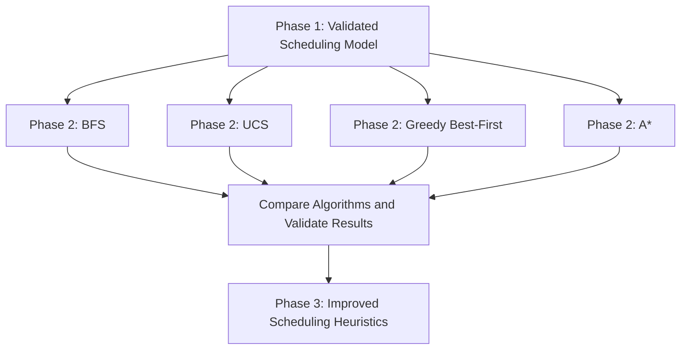

# Heuristic Search for Project Scheduling — Technical Requirements

**Project:** AI-Based Intelligent Project Scheduling and Resource Optimization Using Graph Search and Heuristic Algorithms

This document states **what the system must do**, phase by phase. The business problem is in `Project_Requirements.md` (owner SS). Who builds what, in what order, and what is done is in `Implementation_Plan.md`.

| Phase | Subject |
|---|---|
| [Phase 1](#phase-1--scheduling-model-and-data-validation) | Validated dataset and scheduling state model |
| [Phase 2](#phase-2--search-algorithms) | BFS, UCS, Greedy Best-First and A* on that model |
| [Phase 3](#phase-3--heuristics-handoff) | Stronger heuristics (handoff and implementation summary) |

## Baseline

- **Project:** SS's six-task workforce-training onboarding pilot (T01–T06).
- **Resources:** Two interchangeable coordinators. One and three workers are sensitivity cases.
- **Durations:** Fixed, in whole working days.
- **Dependencies:** Finish-to-start.
- **Expected optimal makespan:** **11 working days** with two workers.

All four search algorithms must use the **same tasks, dependencies, resource limits, goal test and transition rules**. Only the search strategy changes.

## Phase 1 — Scheduling model and data validation

Details are in `Scheduling_Model.md` and `Data_Validation.md`. This section lists the requirements that Phase 2 depends on.

| ID | Requirement |
|---|---|
| P1-01 | `tasks.csv` has exactly four columns: `task_id`, `duration`, `depends_on`, `workers_required`. Any other header is rejected. |
| P1-02 | Durations are positive whole days. Task IDs are valid. |
| P1-03 | Every prerequisite names a real task, and the dependencies contain no cycles. |
| P1-04 | No task needs more workers than the total capacity. Such input is rejected as infeasible. |
| P1-05 | A state records the completed tasks and the running tasks with their remaining days. It does not store the calendar day. |
| P1-06 | A task may start only when all its predecessors are complete and enough workers are free. A worker released at day `t` may start another task at day `t`. |
| P1-07 | A transition starts a chosen set of ready tasks, then advances time to the next task completion. Its cost is the whole days advanced. |
| P1-08 | The goal state has every task complete and none running. |
| P1-09 | A schedule validator checks dependencies and worker capacity. It checks feasibility only and does not find optimal schedules. |

## Phase 2 — Search algorithms

### Objectives

The system must be able to:

1. Read and use the validated project dataset from Phase 1.
2. Generate valid scheduling states using the existing transition functions.
3. Implement all four search algorithms.
4. Find a complete project schedule with each algorithm.
5. Calculate task start times, finish times and the total project completion time (**makespan**).
6. Compare the algorithms by makespan, states explored and execution time.
7. Verify that schedules satisfy task dependencies and resource constraints.

### Algorithm requirements

#### BFS

- Use a **FIFO queue** to explore scheduling states level by level.
- Find a complete, valid schedule with the fewest **search transitions** in the modeled state graph.
- **Do not claim** BFS minimizes makespan: transitions may advance different amounts of working time.
- Return the schedule, completion time, expanded-state count and execution time.

Deliverable: `bfs.py`

#### UCS

- Use a **priority queue** ordered by cumulative elapsed time, **g(n)**.
- Use elapsed working days as transition costs.
- Track the best-known cost for each state and update it when a cheaper route is found.
- Under a correct and complete search model with nonnegative transition costs, UCS must find a minimum-duration schedule.
- Return the schedule, makespan, expanded-state count and execution time.

Deliverable: `ucs.py`

#### Greedy Best-First Search

- Use a **priority queue** ordered by estimated remaining time, **h(n)**.
- Begin with a simple heuristic, such as the longest remaining individual task duration (accounting for any already-running tasks).
- Greedy may reach a solution quickly without guaranteeing an optimal makespan.
- Return the schedule, makespan, expanded-state count and execution time.

Deliverable: `greedy.py`

#### A*

- Use the evaluation function f(n) = g(n) + h(n), where g(n) is elapsed time and h(n) estimates the remaining time.
- Begin with an **admissible** heuristic. h(n) = 0 is the baseline and makes A* equivalent to UCS in search priority.
- Track best-known costs and support improved paths to previously encountered states.
- Verify that A* produces the same optimal makespan as UCS on the baseline when the heuristic is admissible.
- More informative, scheduling-aware heuristics belong to Phase 3.
- Return the schedule, makespan, expanded-state count and execution time.

Deliverable: `astar.py`

### Common technical requirements

| ID | Requirement |
|---|---|
| TR-01 | Use the validated Phase 1 task dataset. |
| TR-02 | Use the same initial state and goal test for all algorithms. |
| TR-03 | Generate successor states through `scheduling_model.py`. |
| TR-04 | Do not start tasks until all dependencies are complete. |
| TR-05 | Never exceed worker capacity. |
| TR-06 | Never start or complete the same task more than once. |
| TR-07 | Track running tasks and their remaining durations. |
| TR-08 | Calculate transition costs from elapsed working days. |
| TR-09 | Track visited states and/or best-known costs appropriately for each algorithm. |
| TR-10 | Reconstruct the complete task schedule from the search result. |
| TR-11 | Count expanded states and measure execution time consistently. |
| TR-12 | Report unsolvable inputs and search timeouts explicitly. Never output an invalid schedule as a success. |

**Modeling note:** The successor generator must allow the scheduling choices required for a valid optimality claim. In particular, it must not *automatically* force all eligible tasks to start simply because workers are free. Delaying a task can matter in more complex resource-constrained instances.

### Standard algorithm output

Each algorithm returns results in a common structure:

```python
{
    "algorithm": "A*",
    "makespan": 11,
    "schedule": [
        # Each entry: task_id, start_time, finish_time
    ],
    "states_explored": 0,
    "execution_time_ms": 0.0,
    "schedule_valid": True,
}
```

`states_explored = 0` and `execution_time_ms = 0.0` are placeholders, not results. The implementation also returns a `status` (`solved`, `no solution`, `timeout` or `invalid input`) and an `error` message when a run does not succeed.

Comparison table to report (values come from actual runs, written to `comparison.csv`):

| Algorithm | Makespan | Expanded states | Runtime | Valid? |
|---|---:|---:|---:|---|
| BFS | measured | measured | measured | verified |
| UCS | 11 expected | measured | measured | verified |
| Greedy Best-First | measured | measured | measured | verified |
| A* with admissible heuristic | 11 expected | measured | measured | verified |

### Test requirements

| Test case | Expected outcome |
|---|---|
| Six-task baseline, **two workers** | UCS and admissible A* return **11 days**. |
| **One worker** | Minimum makespan is **15 days**. |
| **Three workers** | Minimum makespan is **9 days**. |
| T05 duration increases from **2 to 3 days**, two workers | Minimum makespan is **12 days**. |
| All tasks independent | Schedule still respects resource capacity. |
| All tasks form a dependency chain | Tasks execute in prerequisite order. |
| A task needs more workers than total available | Input is rejected as infeasible. |
| No valid solution | Search reports failure, without returning an invalid schedule. |

The first four reference values come from SS's six-task requirements and suggested business refinements. The other cases check general algorithm and model behavior.

## Phase 3 — Heuristics

Phase 3 improves the heuristic used by Greedy and A*, and tests whether a better estimate of remaining time reduces search effort. The objective stays **minimum makespan** in whole working days. Cost, revenue and worker skills are not part of the objective. Worker qualifications (for example a qualified registration worker for T03) need worker identity in the model and are a future extension, not a Phase 3 criterion.

### Research questions

- **Main:** Can a heuristic that considers task dependencies and available workers reduce the number of states explored while A* still finds the minimum makespan?
- How much does a critical-path bound improve on a basic unfinished-task estimate?
- Does a workload bound improve search efficiency further?
- Does the improvement change with worker capacity, durations or project size?
- When does Greedy produce a faster but longer schedule?

### Entry conditions (all met in Phase 2)

Phase 1 validation tests pass. BFS, UCS, Greedy and A* each return a valid schedule for the baseline. UCS and A* with h = 0 find the 11-day optimum. Every search returns the common result structure. Invalid schedules and impossible inputs are rejected clearly.

### Notation

State: `completed` (frozenset of task ids) and `running` (tuple of `(task_id, remaining_days)`). A transition advances time to the next task completion, and its cost is the number of elapsed days.

- `U(n)`: tasks not yet completed, including running tasks.
- `r_i(n)`: remaining duration of task i. It is 0 if completed, the remaining days if running, and the full duration if not started.
- `w_i`: workers needed by task i. `R`: total worker capacity.
- `g(n)`: days elapsed along the path. `h(n)`: estimated minimum remaining days.

Every heuristic returns 0 at a completed goal. **Use remaining work, not original duration.** If T02 takes four days and has one day left, its remaining duration is 1. Using 4 could overestimate and break admissibility.

### Heuristics

| ID | Function in `heuristics.py` | Definition |
|---|---|---|
| H0 | `zero_heuristic` | `h0(n) = 0`. Control. A* with H0 behaves like UCS apart from tie-breaking. |
| H1 | `longest_remaining` | `h1(n) = max r_i(n)` over `U(n)`; 0 if nothing is unfinished. |
| H2 | `critical_path_remaining` | `L(i,n) = r_i(n) + max L(j,n)` over the direct successors j of i that are in `U(n)` (0 if none). `h2(n) = max L(i,n)` over `U(n)`. Memoize `L` within each call. |
| H3 | `combined_heuristic` | `hW(n) = ceil( sum(w_i * r_i(n)) / R )` over `U(n)` (this is `workload_remaining`). `h3(n) = max(h2(n), hW(n))`. |

Use the **maximum**, not the sum. Some worker effort lies on the critical path, so adding the two bounds would double-count it.

**Admissibility.** Tasks on one dependency chain run one after another, so the remaining makespan is at least `h2`. Unfinished worker-days must be supplied by at most R workers per day, so it is at least `hW`. The larger of two lower bounds is a lower bound, and the same reasoning covers H1. This holds for the Phase 1 model: fixed positive durations, no interruption, no release dates, shared worker capacity.

**Baseline values** (Day 0, two workers, durations 2, 4, 3, 3, 2, 1):

| Estimate | Value | Reason |
|---|---:|---|
| H0 | 0 | Zero baseline |
| H1 | 4 | Longest task is T02 |
| H2 | 9 | T01, T02, T05, T06 = 2+4+2+1 |
| hW | 8 | ceil(15 / 2) |
| H3 | 9 | max(9, 8) |
| Optimal makespan | 11 | Reference solution |

The heuristics are optimistic. A 9-day bound does not mean a 9-day schedule exists. The 11-day schedule is optimal because the three middle tasks (4, 3 and 3 days) need at least six days on two workers, in addition to T01, T05 and T06.

### Implementation requirements

| ID | Requirement |
|---|---|
| H-01 to H-05 | Implement H0, H1, the critical-path bound, the workload bound, and H3 as `max(h2, hW)`. Running tasks use remaining days. |
| H-06 | All heuristics return 0 for a completed goal. |
| H-07 | Greedy and A* take the heuristic as an argument `h(state, tasks, capacity)`, so heuristics swap without changing `successors()`. |
| H-08 | Heuristics have no side effects. They do not change tasks, states or capacity. |
| H-09 | A* reopens a state when a cheaper path to it is found. |
| H-10 | Compare variants on identical input, algorithm settings and measurement definitions. |
| H-11 | Every reported schedule passes the schedule validator. |
| H-12 | Timeouts and state limits are recorded as incomplete runs, never as solutions. |

All algorithms use the same scheduling model and state representation. Heuristics do not re-implement scheduling constraints.

### Test requirements

| Test | Expected behavior |
|---|---|
| HT-01 Completed goal | H0 to H3 return 0 |
| HT-02 Baseline at Day 0 | H0=0, H1=4, H2=9, workload=8, H3=9 |
| HT-03 Partly done running task | Remaining work is used (1 day, not 4) |
| HT-04 Single dependency chain | Critical-path bound equals the sum of remaining durations |
| HT-05 Independent tasks | Workload bound reflects capacity |
| HT-06 One worker | Workload bound equals all remaining worker-days |
| HT-07 Invalid input (cycle, bad duration, over capacity) | Validation rejects it before any heuristic runs |
| HT-08 Every legal transition | Values are non-negative integers; no mutation |
| HT-09 Admissibility | For every reachable state of the small instances, `0 <= h(state) <= exact cost-to-goal` |
| HT-10 A* on reference cases | A* with each admissible heuristic matches the UCS makespan |
| HT-11 Repeated runs | Same makespan and state counts; runtime may vary |

If a test fails, first check running-task remaining times, the dependency graph and the best-cost reopening logic. Do not change the reference answer to make a test pass.

Business reference scenarios (from SS), compared in `Heuristic_Scenarios.md`:

| Scenario | Optimal makespan |
|---|---:|
| Baseline, one worker | 15 |
| Baseline, two workers | 11 |
| Baseline, three workers | 9 |
| Two workers, T05 from two to three days | 12 |

### Search comparison and measurement rules

Compare on the same instance: UCS (reference), A* with H0, H1, H2 and H3, and Greedy with H1 and H3. BFS results from Phase 2 stay available as an uninformed comparison.

| Metric | Definition |
|---|---|
| `makespan_days` | Finish time of the last task in the returned valid schedule |
| `states_expanded` | States taken from the frontier and expanded, excluding stale entries |
| `states_generated` | Successors generated during expansion |
| `runtime_ms` | Wall-clock time of the search call, heuristic time included, parsing and plotting excluded |
| `solution_valid` | Schedule passes precedence, capacity, duration and completeness checks |
| `optimality_gap_pct` | `100 * (makespan - optimum) / optimum` when the optimum is known |
| `search_status` | `solved`, `no solution`, `timeout`, `state_limit`, `invalid input` or `error` |

Experiment settings: SS's six-task case is the correctness baseline. Add seeded synthetic instances of 8 to 12 tasks with different dependency structures. Use one timeout and one expansion limit for every method, and record incomplete runs separately. Time each run five times and report the median, on one machine. Change one input factor at a time in controlled comparisons.

An admissible heuristic does not shorten the optimum. UCS and admissible A* must return the same makespan. H3 can expand as many states as H2 on some instances because of overhead, duplicate paths and tie-breaking. Do not promise a speedup.

`heuristic_results.csv` has these 13 columns:

```csv
scenario_id,seed,task_count,worker_capacity,algorithm,heuristic,search_status,makespan_days,states_expanded,states_generated,runtime_ms,solution_valid,optimality_gap_pct
```

Measured columns are never filled with invented values. A failed or incomplete run is never reported as optimal.

### Completion criteria

- H0 to H3 are implemented in `heuristics.py`, with formulas and assumptions documented.
- Unit tests cover goal states, partly done running work, dependencies and capacity.
- Admissibility passes against exact cost-to-goal on the small instances.
- A* with H1, H2 and H3 matches UCS on the SS reference cases.
- Greedy and A* run with several heuristics on the same state model, and every schedule passes the validator.
- The comparison covers the SS baseline and additional synthetic cases, and `heuristic_results.csv` is reproducible with incomplete runs handled clearly.
- `Heuristic_Analysis.md` explains findings, limits and unexpected results. Comparison figures and SS's review of the business interpretation are still open (see `Implementation_Plan.md`).

### Handoff to Phase 4

`heuristics.py`, `test_heuristics.py`, `heuristic_test_data/`, `heuristic_results.csv` and `Heuristic_Analysis.md` feed Phase 4: a wider evaluation on varied synthetic projects and, if feasible, PSPLIB instances. An optional ML model that predicts remaining time may be tried as a search heuristic. Such a heuristic can overestimate, so do not claim A* optimality for it without further justification.

### Phase 3 implementation

| Item | File | Notes |
|---|---|---|
| Synthetic instances | `heuristic_data.py` | `python -m experiments.heuristic_data` writes `heuristic_test_data/` (6 CSVs and `NOTES.md`) |
| Results file format | `heuristic_io.py` | Reads and writes the 13-column `heuristic_results.csv` |
| Comparison | `heuristic_comparison.py` | `python -m experiments.heuristic_comparison [--output] [--timeout] [--max-expansions]`. Runs UCS, A* (H0 to H3) and Greedy (H1, H3) on 10 instances. Exit code 0 success, 1 optimality mismatch or load/write failure, 2 bad option or path |
| Summary | `heuristic_summary.py` | `python -m experiments.heuristic_summary results/heuristic_results.csv` prints a markdown table (exit 0, or 2 for a bad path) |
| Tests | `test_heuristics.py` | `python -m unittest -v tests.test_heuristics` (29 tests) |
| Results | `heuristic_results.csv` | 70 rows |
| Scenarios | `Heuristic_Scenarios.md` | Draft, SS review pending |
| Analysis | `Heuristic_Analysis.md` | Findings and limits |

Search-engine additions: each result has a `states_generated` key, `ucs_search`, `astar_search`, `greedy_search` and `bfs_search` accept `max_expansions`, and a run that hits the limit returns status `state_limit`. This is a fifth `status` value next to the four listed in Phase 2 output.

Comparison figures (P3.8) were not made. No plotting dependency was added.

